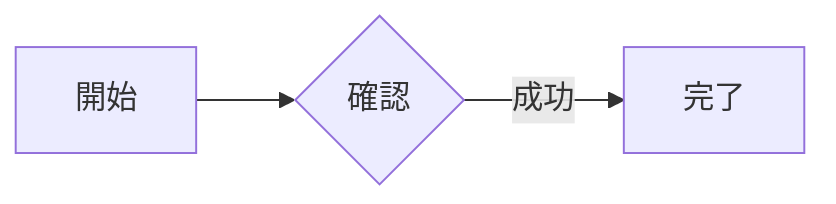

# UI 開発ガイド

ワークスペースはタスク起動・待機処理・最新サマリを担い、実行履歴は単回 Run の完全な記録を担う。実装は [web/src](../../SKM/web/src/)、送信と復旧境界は[実行・データ保守ガイド](../development/runtime-guide.md)を参照する。

## 視覚規約

新規画面も既存ワークベンチの余白・整列・情報階層を踏襲し、別系統の視覚ルールを作らない。

- **テーマと基本スタイル**：暖灰の夜間・クリーム色の昼間テーマと暖色アクセントを再利用し、[共有スタイル](../../SKM/web/src/styles/base.css)・[読書レイアウト](../../SKM/web/src/styles/reading.css)・[線画アイコン](../../SKM/web/src/components/routeIcons.tsx)に従う。三語はメッセージカタログで統一し、テーマ切替でフォームを再構築しない。PC 1440×900 を基準に 1366×768・1920×1080・390px 狭幅に対応する。
- **操作階層と一覧**：各領域の主操作は 1 つに絞り、改名・移動・無効化・削除などの管理操作は常駐の `⋯` メニューに収める（hover 依存にしない）。一覧見出しはタスク名を表示し、履歴の実行名は元の束縛バージョンから読み取る（ID・版・ハッシュは技術詳細へ置く）。長文は折り返し、文字縮小や横溢れを起こさない。フォルダのチェックボックスは現在の絞込範囲のみを選択し、選択時のみ一括操作バーを表示する。
- **レイアウトとコンテナ**：画面間移動はサイドバー、同一画面内の切替はタブ（待機中・進行中・レポートは同幅）を使う。短い補足は折りたたみ、資源・証拠・評価はドロワー、削除/回収確認はコンパクトなダイアログ（対象名・パス/ID・影響を明示し、対象一覧のみ有界スクロール）を使い、ダイアログを入れ子にしない。アカウント（本人・API Key・組織ユーザー）はタブ、Project 作成/編集はドロワーを使い、実行・定期実行の送信ボタンはフォームの固定フッターに置く。
- **Select と Autocomplete**：単一選択は共有 `Select`（Base UI Select）で統一し、ブラウザ固有の `appearance: base-select` に頼らず境界・影・選択色・チェックマーク枠（未選択行も幅を固定）を描画する。長文選択肢は折り返してスクロールし、popup が Escape を処理した際は親ダイアログを閉じない。文書アップロード先は Base UI Autocomplete を用いた `DocumentFolderInput` とし、ルート・既存階層候補・新規自由入力パスを保持する。
- **コントロール密度と余白**：言語・状態・評価点・真偽値・スケジュール等の短い候補は `compact` 密度とし、フィールド幅を制限して隣接入力と高さを揃える（資源・文書・パス等の長い項目には適用しない）。有界スクロールの候補一覧・メニューは左右対称のスクロールバー余白を確保し、短いメニューや非スクロールのダイアログには空の余白を予約しない。Checkbox/Radio にテキスト入力の幅・最小高・padding を継承させない。
- **フォーカスと下書き保持**：hover は中立色、選択は淡い強調色とチェックマーク、キーボード焦点は枠線で区別し、ポインタ操作へ戻った際に焦点枠を残さない。タブは現在項目のみを Tab 順序に置き（矢印/Home/End 対応）、タブ切替・ドロワー閉鎖・背景再読込で入力下書きや現在フォーカス、未確認要求を破棄しない。
- **入力と実行表示**：自由記述は全幅の複数行入力とし、対話は元の全文と改行を保持する。Workspace 起動後は起動・画面移動と現在 Run の更新・取消を別の操作群にし、狭幅でも短いボタンを揃える。実行中は発生済みイベント・接続状態・実所要時間を表示し、根拠のない進捗率を作らない。エラーは失敗箇所・原因・次の操作を明示する。
- **実行詳細の階層**：タスク名を主見出しにし、状態・作成時刻・所要時間・Run 識別を同じヘッダーへ集約する。タブ下線・進捗行・本文枠の間に一定の余白を設け、要約内へ外枠を重ねない。実行中の最新観測は短い開閉行に置き、直近イベントと payload は展開して読む。

## ナビゲーションとタスク

[共通ルーティング](../../SKM/web/src/lib/routing.ts)で正確な Project/Run/Task を扱う。概要・ワークスペース・レポート・スケジュール・履歴からの実行リンクはすべて実行履歴詳細を開き、サイドバーも実行履歴を選択状態にする。Project 切替時は旧 Run/Task をクリアし、Project 削除確認後は再選択へ案内する（応答不明時は照合用に元対象を保持する）。

アーカイブ済み Project の完全削除は、終了済み実行（ごみ箱含む）・Project 文書（原入力含む）・定期実行・設定を一括削除し、組織 Skill・外部業務データ・独立監査を保持する。ファイル清掃は DB コミット後に行い、失敗時は記録と未清掃件数を表示する。

タスク一覧は名称・識別子・定期実行状態で検索でき、カード内にスケジュール状態と設定入口（毎日・毎週・高度な cron、時刻プレビューと保存検証を共有）を持つ。起動フォームとスケジュールは [TaskLaunchFields](../../SKM/web/src/components/TaskLaunchFields.tsx) と `taskDraft` を共用し、ディレクトリ選択時は配下の利用可能文書を一括選択する。

## レポートとプレビュー

「完了とレポート」はタスクごとに最新終態実行のサマリ・状態・所要時間・詳細入口を表示する（最新が失敗・取消のとき過去の成功レポートへ巻き戻さない）。添付・証拠・評価・技術記録は実行詳細に集約し、長い添付一覧は結果参照分を優先表示して残りを折りたたみ可能にする。

- **安全と形式の境界**：テンプレートは業務結論・制限・引用を保持し、`SUCCEEDED` から業務 `PASS` を推測しない。JSON は数値精度・重複キー・元のダウンロード byte を保って整形表示し、HTML preview は sanitizer と無スクリプト sandbox を通し外部資源と遷移を禁止する。
- **20 MB 共通プレビュー**：文書庫の PNG/JPEG/GIF は認証付き endpoint から byte を取得し MIME・署名を検証して表示する（閉鎖・対象切替で Blob URL を破棄）。SVG と未対応形式はダウンロードを維持する。画像・テキスト文書の preview 上限は実 byte で 20 MB（20,000,000 byte）とし、Run 添付も同じ preview 部品を使う（添付の公開・保存契約自体は 1 MiB のまま維持）。
- **Worker 分割 Markdown プレビュー**：文書管理・レポート・抜粋はキャンセル可能な Worker で分割解析し、表を行境界で分割して表頭を再掲し、現在ページの DOM のみ描画する。部分表の抜粋は同一 Run/path/hash の原読取記録で確認できた表頭と完全行のみを表示投影へ補う（原 Evidence は不変）。巨大ブロック・大 HTML・解析失敗・タイムアウトは理由付きの原文ページへ降格し、元ファイルのダウンロードを維持する。
- **静的 Mermaid フローチャート**：明示的な `mermaid` コードブロックの基本 `flowchart`/`graph` は、現在ページに図がある時のみ遅延読込して静的フローチャートとして描画する（通常本文の `A→B→C` から図を推測しない）：

配色は親テーマに追随し、SVG は狭幅へ縮小して有界領域でスクロールする。基本ノード・矢印・短いラベルのみ再構成し、`click`・URL・HTML・画像・設定指令・`style` は実行しない。出力 SVG も sanitizer と無スクリプト sandbox/CSP を通し、未対応構文や予算超過時は理由と元のコードを表示する。

## 管理操作と非同期状態

- **要求のべき等性と下書き分離**：文書/フォルダ管理、ごみ箱、アカウント操作は元の主体・二重送信防止・版競合・結果不明時の照合を共有する。通信失敗はロールバックを意味しないため別 key で自動再送せず、閉鎖・対象切替・アンマウント後の遅延応答は無視する。
- **入力検証と読込状態**：JSON 入力は編集中の不正文字列も下書き保持し、構文/型エラー解消まで送信を止める。Skill の解析・保存・解釈は確認済み原文 snapshot に紐付け、原文変更後は再解析を案内する（下書き未作成の解析完了結果はリロード復元に対応し、モデルを再呼出しない）。
- **一覧と集計の事実性**：候補・Project 有効化・モジュール・タスク・資源カタログは `loading`/`error`/`ready-empty` を区別し、読取失敗を「未設定」と表示しない。絞込・ページング・件数はサーバー事実を使い、1 ページ目のローカル絞込を全量と偽らない。フォルダ検索は一致パスを展開し空フォルダも検索可能とする。Skill 版はスキル単位で折りたたみ、メンバー候補の参加済み/無効ユーザーは現在ページ内で折りたたむ。

## 検証入口

[ブラウザ回帰](../development/local-development.md#ブラウザ回帰)を実行し、共通レイアウト変更時は双テーマ・三語・PC/狭幅で空状態・多件・長名称・キーボード・失敗・遅延応答を確認する。
[全体外観検査](../../SKM/web/tests/browser/check_visual_style.py)と[読書検査](../../SKM/web/tests/browser/check_reading.py)は mock を使用するため、実配備のフォント・権限・ネットワーク・永続化は別途検証する。

