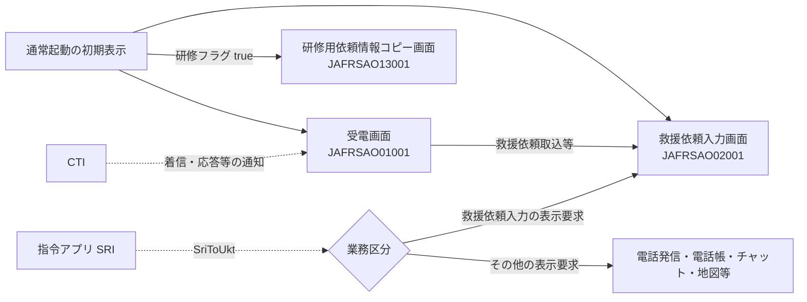
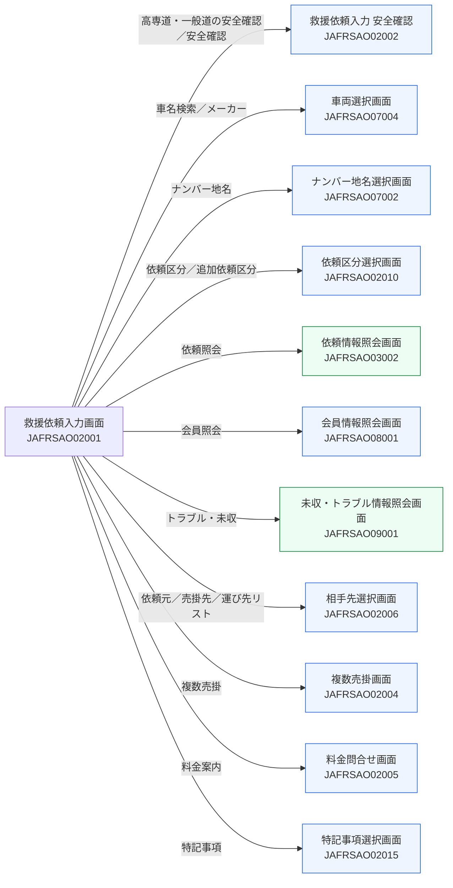
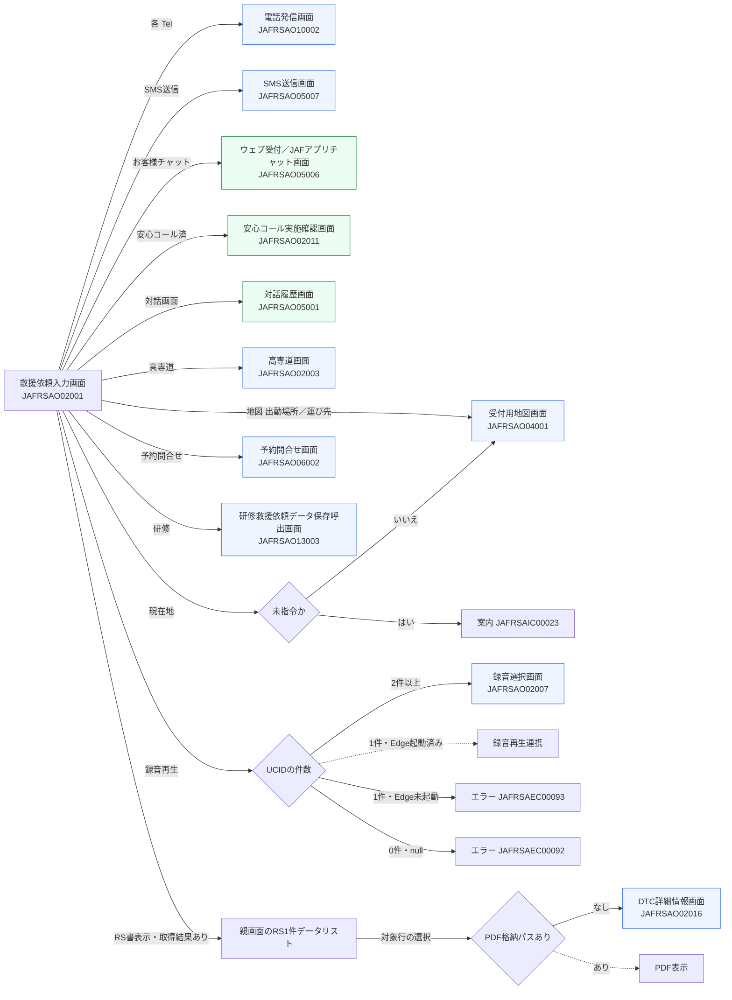
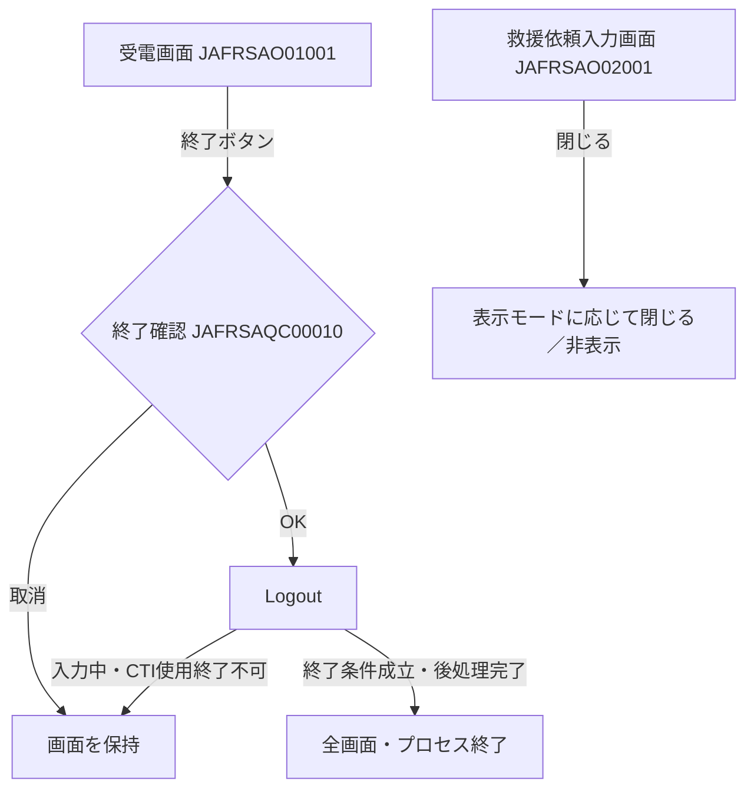

# 受付アプリの画面遷移

## 主画面と連携表示

受電画面 `JAFRSAO01001` は電話の着信・応答を扱い、救援依頼取込等の操作で受電情報を救援依頼入力画面 `JAFRSAO02001` へ渡す。救援依頼入力画面は、新規・修正・共有・読み取り専用等の表示モードと入力状態に応じて、関連画面を開く。

- `SriToUkt` は業務区分に応じて画面を表示・再表示する。既存の救援依頼入力画面への要求では、デシリアライズ後に入力状態を確認し、`!FlgAutoUpdate && !FgReadOnly` の場合に編集中として拒否する。
- `FgReadOnly` は既存画面の現在の入力状態であり、要求側の読み取り専用表示指定 `FlgReadOnly` と区別する。自動更新要求は別の分岐で扱う。
- `CtiToUkt` は着信・応答等の通知を受電画面の処理へ渡す。通知内容に応じた表示更新を行う。

## 救援依頼入力から子画面への遷移

以下の図は、救援依頼入力画面からの現行の呼出しを示す。青色はモーダル表示、緑色はモードレス表示。モーダル表示では子画面の操作完了を待ち、モードレス表示では独立したウィンドウを開く。

### 安全確認・選択・照会

### 連絡・指令・研修・資料

「高専道(安全確認)」は安全確認画面を開き、「高専道」は道路・指令等の情報を扱う高専道画面を開く。別の操作として対応付ける。

「RS書表示」は取得結果がある場合に親画面のRS1件データリストを表示する。選択した行のPDF格納パスによって、DTC詳細情報画面またはPDF表示へ進む。

録音の件数、未指令判定、権限、参照状態、予約の入力チェック等の条件により、子画面を開く前に案内・エラーで終了する経路がある。

子画面を閉じた後は、選択・確認結果、`DialogResult`、戻りデータ、コールバック等の条件に応じて親画面へ反映する。既存ウィンドウの再利用・閉じて作り直す処理は画面ごとに異なる。お客様チャット等の参照指定は、画面表示後の操作可否にも関係する。

## 閉じる・アプリ終了

救援依頼入力画面の閉じる操作は、表示モードに応じて当該画面を閉じる／非表示にする。受電画面の終了操作は、確認後にアプリ全体の `Logout` を呼ぶ。

CTI終了時等の結果・エラーコードに応じて、警告ダイアログ画面 `JAFRSAO02012` を表示する経路がある。ウィンドウの表示状態と、終了ログ・DB後処理・プロセス終了はそれぞれ確認する。
